# Clustering-Based LLM Router
### Offline calibration → runtime routing

Status as of November 2026 · 4 candidate models

---

## The big picture

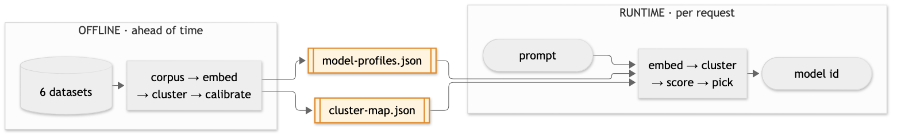

Offline builds two files. The runtime only reads them.

---

## Offline pipeline

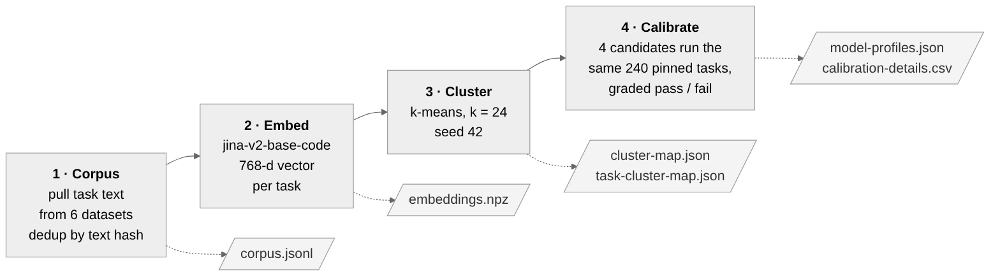

Four stages, each writing a file the next one reads. Adding a model re-runs only stage 4, for that model.

---

## Datasets

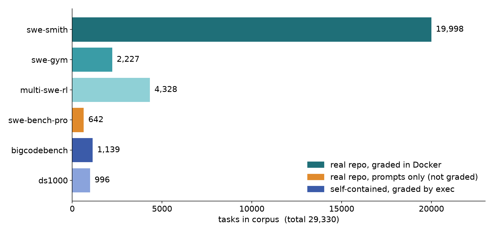

6 public sources, ~29k real tasks. Colour = how a source's tasks get graded. SWE-bench Pro prompts are mapped onto the clusters but not graded.

---

## Datasets in cluster space

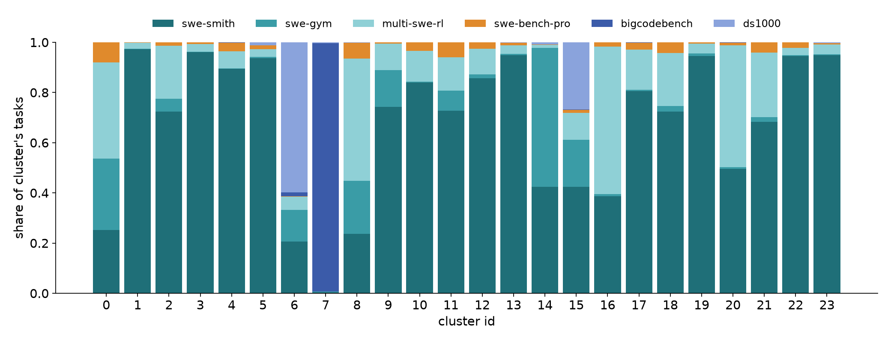

Standalone coding separates out (cluster 7 is 99% BigCodeBench, cluster 6 is 60% DS-1000). Repo tasks spread across the rest.

---

<!-- _class: dense -->

## What each dataset cost us

| Dataset | Pinned tasks | Main problem we hit | Fix |
|---|---|---|---|
| SWE-smith | 154 | Agent saw clean code, not the injected bug | Apply + commit the bug patch as the agent's start |
| SWE-Gym | 17 | ~2.8% of test IDs unselectable (non-ASCII) | Collect-only pass, drop only the bad IDs |
| Multi-SWE-RL | 46 | `go test` exit code lies; test-name prefix collisions; Java suites fail unpatched | Read each target test's own result line / report |
| BigCodeBench | 9 | Candidate could print a fake `RESULT: PASS` | Per-call random nonce in the result line |
| DS-1000 | 14 | Matplotlib rows grade by image comparison | Excluded from calibration |

Every one of these looked like a weaker model, not like an error. The gate (gold ≈ 100%, empty ≈ 0%) caught most of them.

---

## How calibration works

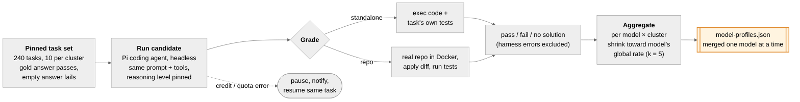

Every model runs the same 240 pinned tasks. A credit/quota error pauses the run instead of silently skipping tasks.

---

## How a task is graded

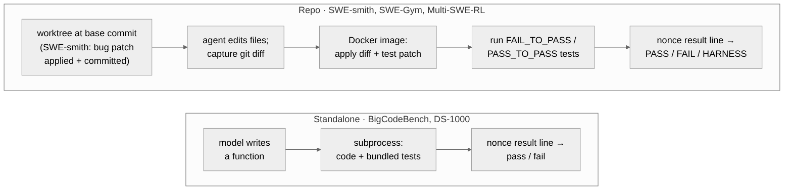

Pass means the task's own tests pass, nothing judged by an LLM. Harness errors, timeouts and missing deps are excluded, never counted as model failures.

---

## Artifacts produced

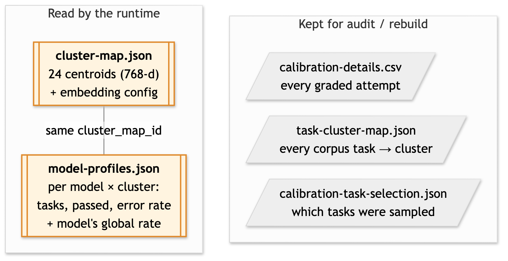

The runtime refuses to load a pair with mismatched <code>cluster_map_id</code>.

---

## The candidates

| Model | Price tier | $ / 1M tokens (in / out) | Reasoning |
|---|---|---|---|
| gpt-6.1-sol | **high** (flagship) | $2.00 / $10.00 | medium (pinned) |
| gpt-5.4-mini | **mid** | $0.75 / $4.50 | medium (pinned) |
| gpt-5.6-luna | **low** | $0.20 / $1.20 | Pi default |
| gpt-5-nano | **lowest** | $0.05 / $0.40 | Pi default |

Tier = price band on the same min-max scale the router's cost term uses. All four ran the full 240-task set. gpt-5-nano retires Dec 11, 2026.

---

## Model profiles: current snapshot

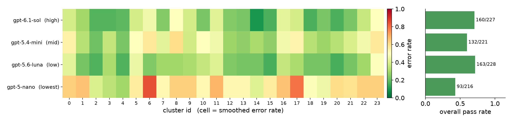

- luna and sol are statistically tied overall (±6 pp at ~220 graded tasks); both clearly beat mini, which clearly beats nano.
- Per cluster, evidence is thin: ~10 tasks each, so ±30 pp. Big gaps (anything vs. nano) are real; most sol-vs-luna gaps are not.

---

## Results

| Model | Pass rate (graded) | Excluded | Spend, 240 tasks | Avg. turns |
|---|---|---|---|---|
| gpt-5.6-luna | **71.5%** (163/228) | 12 | not retained | — |
| gpt-6.1-sol | **70.5%** (160/227) | 13 | **$7.35** | **7.1** |
| gpt-5.4-mini | 59.7% (132/221) | 19 | $14.73 | 14.6 |
| gpt-5-nano | 43.1% (93/216) | 24 | not retained | — |

On the same 220 tasks, sol solved 29 that mini didn't; mini solved 6 that sol didn't.

---

## List price is the wrong cost signal

- By list price, mini is **less than half** sol's price. In practice it cost **2× more** to run the same 240 tasks.
- mini took **14.6 turns** per task vs. sol's 7.1, and produced ~**1.1M output tokens** vs. ~206K. Reasoning tokens bill as output.
- Our pre-run estimate for mini ($3–6, scaled from sol by price ratio) was off by more than 2×.

For agents, cost per task depends on behaviour, not price per token. Next step: use observed cost per task in the cost term.

---

## Runtime overview

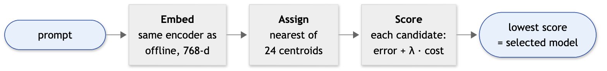

No state, no training, no calls to candidates. Scoring is under 1 ms; embedding dominates (~0.1–0.2 s warm).

---

## Inputs and their purpose

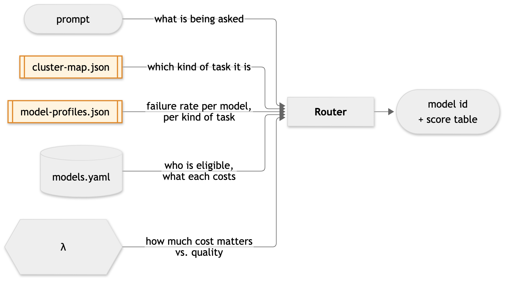

---

## The control knob: λ

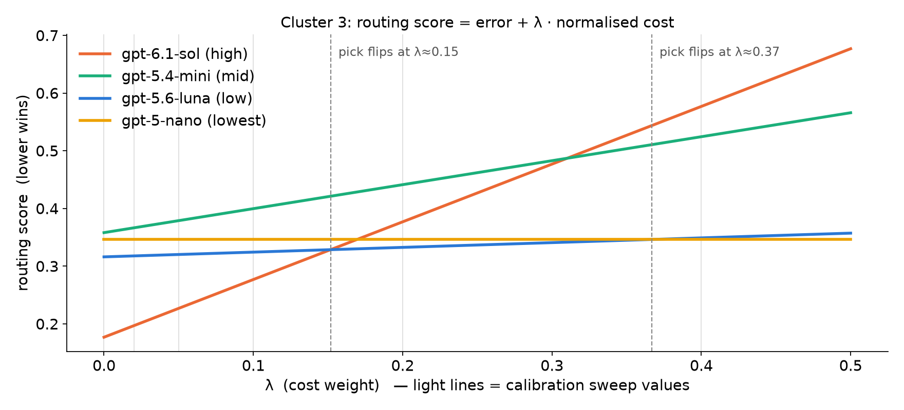

<b>score = error + λ × normalised cost</b>. In cluster 3 (Word/PowerPoint tasks) the pick goes high → low → lowest tier: sol, luna at λ ≈ 0.15, nano at λ ≈ 0.37.

---

## Who the router picks as λ grows

| λ | Clusters to luna / sol / nano | Corpus prompts going to sol |
|---|---|---|
| 0 | 17 / 7 / 0 | 31% |
| 0.05 | 18 / 6 / 0 | 28% |
| 0.10 | 21 / 3 / 0 | 15% |
| 0.20 | 24 / 0 / 0 | 0% |
| 0.40 | 23 / 0 / 1 | 0% |

- **mini never wins a cluster at any λ**: luna is cheaper and more accurate everywhere.
- sol holds longest (to λ ≈ 0.14) in Word/PowerPoint, web/HTTP-framework and SWE-Gym data-library clusters.

---

## Router UI

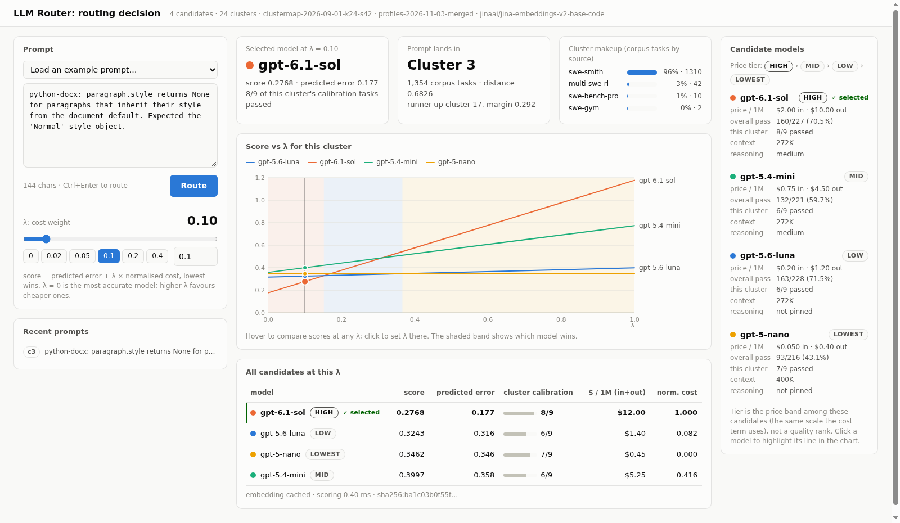

<code>router runtime ui</code>: type a prompt, move λ, see the cluster, every candidate's score, where the pick switches, and each model's tier. No LLM calls.

---

## Limitations and next steps

- **No held-out evaluation yet.** In-sample, routing at λ = 0 reaches 76% vs. ~72% for always-sol. That's an upper bound, not a measured gain. Next: SWE-bench Verified.
- **Cost term uses list price.** Replace it with observed cost per task from calibration.
- **Thin samples.** 10 tasks per cluster vs. the 20+ target; SWE-smith is 64% of the pinned set, standalone tasks only 23.
- **Not wired into the agent yet.** CLI and UI only; Pi integration, escalation and budget limits still to do.
- **Roster churn.** gpt-5-nano retires Dec 11, 2026, so a replacement needs calibrating.
